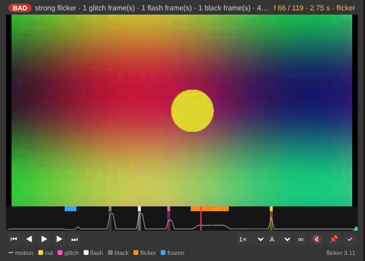
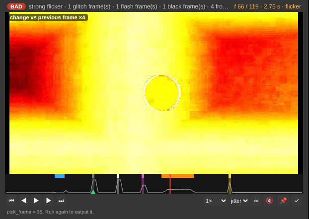
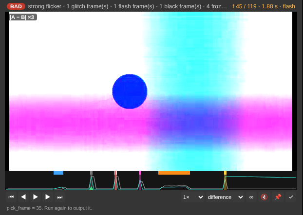

# Ragha Video Inspector

**Find the bad frames in an AI video before you use it, without leaving ComfyUI.**
Ragha Video Inspector plays your clip on the node and checks **every frame** for the problems video models make:
flicker, frozen / duplicate frames, glitch frames, black and flash frames, scene cuts and a broken loop seam.
The problems are drawn on a timeline under the player; click one to jump to it.
Then pick the frame you want (or let it pick the **last good frame**) and get it at full resolution for your next image-to-video run.

It also keeps everything the old *Ragha Preview Video* did: a disk-free preview (kijai's Fast Preview idea, for video), sound, and A/B compare.

> ## Thank you, Kijai
> The disk-free preview was inspired by the **Fast Preview** node in
> [**ComfyUI-KJNodes**](https://github.com/kijai/ComfyUI-KJNodes) by [**kijai**](https://github.com/kijai):
> his idea that a preview does not need to be written to disk is what started this project.
> If you like it, please star KJNodes too.

## What makes it different
Other video nodes either **play** a clip (VideoHelperSuite, core Save Video, Easy-Media, BFS Video Compare, ...) or
**score** a file without showing it (VideoGate, VideoQuality-Metrics). This one does both in a single pass, on one clip,
with no reference video needed:

| | Players / comparers | Metric nodes | **Ragha Video Inspector** |
|---|---|---|---|
| Plays the clip on the node, with sound | ✓ | – | ✓ |
| Checks one clip for flicker, frozen, glitch, black/flash frames, cuts, loop seam | – | partly, no player | ✓ **per frame, on a clickable timeline** |
| Jump to the previous / next problem, step frame by frame | some | – | ✓ |
| "Jitter" view: what changed since the previous frame | – | – | ✓ |
| Pick a frame on the player → full-resolution IMAGE output | – | – | ✓ (or `-2` = last good frame) |
| QC report as a STRING output (works in API / app runs) | – | ✓ | ✓ |
| A/B: slider, side by side, difference, onion skin + A-vs-B curve and PSNR | partly | – | ✓ |
| Writes nothing to disk | – | n/a | ✓ |

## What it checks (every frame, even when the preview is sub-sampled)
| Flag | Colour on the timeline | Meaning |
|---|---|---|
| frozen | blue | the frame is a copy of the previous one (stutter / duplicate frame) |
| glitch | pink | one odd frame that differs from both neighbours while they agree |
| flicker | orange | brightness goes up and down around the frame (a steady fade is *not* flicker) |
| flash | white | a single very bright frame, or a white frame |
| black | grey | a (nearly) black frame. Fades to / from black at the clip edges are reported but not counted as a problem |
| cut | yellow | scene cut: the picture changes completely and stays changed |

Plus a **flicker index** (average brightness jitter in 8-bit levels: under 0.8 is steady, 2 or more is strong), a
**loop-seam** check (does the last frame flow into the first?), the motion curve, and with a B clip the A-vs-B difference
per frame and PSNR. The verdict is **OK / CHECK / BAD**.

## Use it
1. Double-click the canvas, search **Ragha Video Inspector** (category `video/ragha`, internal name `RaghaPreviewVideo`).
2. Connect `images` (for example from *VAE Decode*) or `video` (for example from *Load Video*). Optionally `images_b` / `video_b` to compare, and `audio`.
3. Run. The badge shows the verdict; hover it for the full report.

**Player controls**

| Control | Does |
|---|---|
| timeline | click or drag to seek; hover to see the flags of a frame |
| ⏮ ⏭ | previous / next flagged frame |
| ◀ ▶ (or ← →) | one frame back / forward; space = play / pause |
| speed | 0.25× – 2× |
| view | **A**, **jitter** (change vs previous frame, ×4), and with B: **slider**, **side by side**, **difference** (\|A−B\| ×3), **onion skin** |
| ∞ | loop-seam check: plays the last second into the first |
| 📌 | pick this frame: writes it to `pick_frame`; Run again and `picked_frame` outputs it (the preview is reused, nothing is re-encoded) |
| ✓ | `pick_frame = -2`: the last good frame (skips black, flash and glitch frames at the end) |

| Jitter view (flicker frame lights up) | Difference view, A vs B (flash frame) |
|---|---|
|  |  |

Example workflows are in [`examples/`](examples):
- `ragha_inspect_video.json`: Load Video → Inspector → last good frame + QC report (pick your own clip in *Load Video*)
- `ragha_inspect_images.json`: Empty Image → Inspector (no model, no GPU)
- `ragha_compare.json`: a video against an inverted copy of itself, in *difference* view

### Inputs
| Input | Meaning |
|---|---|
| `images` / `video` | A: frame batch or VIDEO (the VIDEO keeps its own fps and trim). |
| `images_b` / `video_b` | B: a second clip to compare against A, aligned by progress. |
| `audio` | Sound to play with A. Without it, the A video's own audio track is used. |
| `fps` | Playback speed for `images`. |
| `max_size` | Longest side of the preview in pixels. QC and the picked frame always use the full clip. |
| `quality` | Preview quality, 1–100. |
| `max_frames` | `0` = every frame in the preview; otherwise the preview is sub-sampled. QC still checks every frame. |
| `compare` | `slider`, `side by side`, `difference` or `onion skin` (also switchable on the player). |
| `include_audio` | Put the sound in the preview. |
| `refresh_every_run` | Re-encode on every Run even when nothing changed. |
| `pick_frame` | Frame for `picked_frame`: `0, 1, 2, …`, `-1` = last frame, `-2` = last good frame. |
| `analyze` | Run the QC check (on by default). |

### Outputs
| Output | Meaning |
|---|---|
| `images`, `video`, `audio` | Passthrough of the inputs (`audio` falls back to the A video's track). |
| `picked_frame` | The chosen frame at full resolution, decoded by ComfyUI's own video decoder (same colours as *Get Video Components*). |
| `qc_report` | The QC report as text: verdict, flicker, and every flagged frame number. |

Old workflows (1.x) load as they are: the two new settings get their defaults, all other values are kept.

## Performance
Measured on 4 CPU cores, no GPU, 30 s 4K 30 fps video with sound, default settings:

| | 1.3.1 (preview only) | 2.0.0 (preview + full QC + jitter view) |
|---|---|---|
| Time | 5.7 s | 7.8 s |
| Decoding the picked 4K frame | – | +1.4 s |

Frames are decoded, shrunk and analysed one at a time, so RAM does not grow with the length of the video.
The analysis uses ~96-pixel thumbnails taken from the preview frames, which is why it costs so little.
Most of the time is spent decoding the source video.

## Requirements
- ComfyUI with the current frontend (tested: ComfyUI 0.43.0, frontend 1.57.6). No extra pip packages:
  it only uses `torch`, `numpy` and `av` (PyAV), which ComfyUI already installs.
- Works on CPU-only machines.
- Browsers: Chrome / Edge (recommended), Firefox; Safari should work (not tested).

**Big video files:** ComfyUI refuses uploads over **100 MB** by default. Copy the video into ComfyUI's `input` folder
instead, or start ComfyUI with `--max-upload-size 1024`.

## Install
- **ComfyUI-Manager / Comfy Registry:** search for **Ragha** in the Manager, or `comfy node install comfyui-ragha-preview-video`.
- **git:** `cd ComfyUI/custom_nodes && git clone https://github.com/VRH7733/ComfyUI-RaghaPreviewVideo`

Then restart ComfyUI and hard-refresh the browser (Ctrl+F5).

## Self-test
`python tests/test_qc.py` builds a clip with defects planted at known frames (frozen, black, flash, glitch, flicker, cut)
and checks that each one is found at the right frame and that a clean clip comes back with no flags. ComfyUI is not needed.

## How it works
1. **One streaming pass:** each frame is decoded (or read from the batch), shrunk to the preview size, encoded to H.264
   in memory, turned into a tiny thumbnail for the QC analysis, and dropped.
2. **QC:** frame-to-frame differences and brightness on the thumbnails find frozen, glitch, black, flash, flicker and cut
   frames; first vs last frame gives the loop seam.
3. **Shelf:** the clips (A, B, and the jitter view) are kept in a small in-memory store under random tokens; the player
   fetches them from `/ragha_preview_video/clip/<token>`. Nothing touches the disk.
4. **Frame picker:** frame timestamps from the pass let the node decode just the one frame you picked, through ComfyUI's
   own decoder. If only `pick_frame` changed, the preview and QC from the last run are reused.

## Troubleshooting
| Symptom | Fix |
|---|---|
| Node missing from the list | The folder is nested one level too deep, or ComfyUI was not restarted. Check *Import times for custom nodes* in the log. |
| "This preview is no longer in memory" | ComfyUI was restarted, or newer previews pushed it out. Run the node again. |
| A real fade is flagged as flicker | It should not be (steady fades are excluded); please open an issue with the clip. |
| No sound | Click the speaker button. If it is missing, the clip has no audio. |
| `No module named 'av'` | `pip install av` in ComfyUI's Python environment. |

## Licence
**GPL-3.0**. See [`LICENSE`](LICENSE).

## Acknowledgements
- **kijai**: [ComfyUI-KJNodes](https://github.com/kijai/ComfyUI-KJNodes). His Fast Preview inspired the disk-free preview.
- The ComfyUI team: for the open, extensible server and frontend this builds on.
